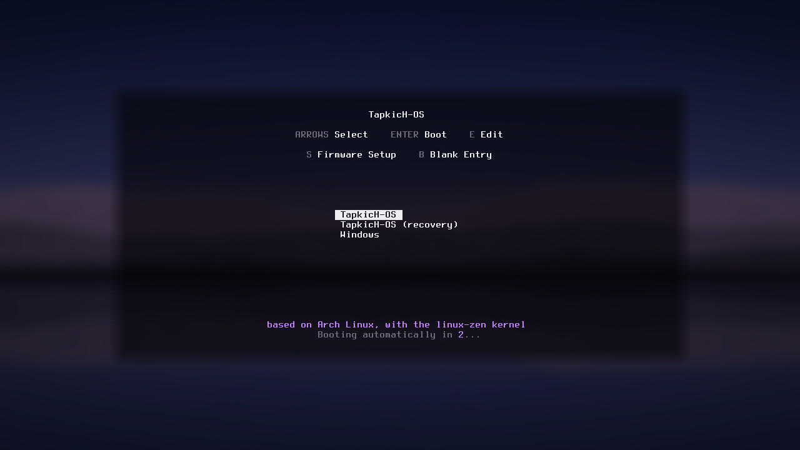
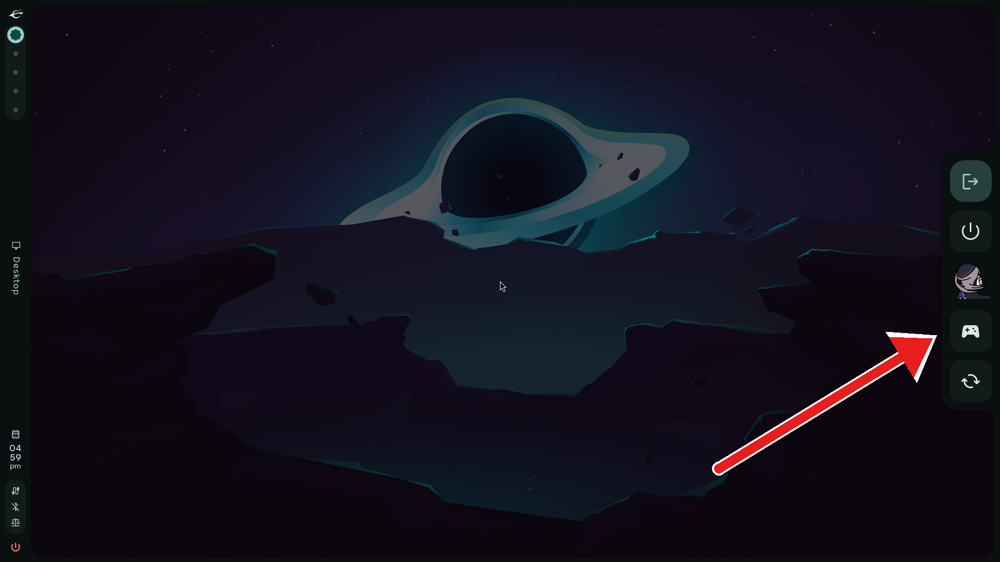

# TapkicH-OS

TapkicH-OS is Arch Linux with the parts you would set up by hand already done. Packages come from the official Arch repositories, so the Arch Wiki applies as usual.

Gaming Mode works just like SteamOS on the Steam Deck. Steam's console interface runs full screen in gamescope, and Steam's own Switch to Desktop brings you back.

  

  
  

|  | Plain Arch | TapkicH-OS |
|---|---|---|
| Install | archinstall or by hand | A guided installer that keeps Windows working |
| Kernel | `linux` | `linux-zen` with zram and a few gaming settings |
| Boot menu | Your choice | Limine, with Windows listed if it is there |
| Desktop | Your choice | Caelestia shell on Hyprland |
| Gaming | Install it yourself | Steam, Lutris, Proton-GE and a Gaming Mode like SteamOS |
| Apps | pacman and the AUR | Bazaar, a simple app store for Flathub apps, plus `tapkich install` for apps like Chrome or 1Password |
| AUR helper | Install it yourself | `paru` |
| Updates | `pacman -Syu` | `tapkich update` runs pacman, paru and Flatpak in one go |
| Secure Boot | Set it up yourself | `tapkich secureboot setup` keeps Microsoft's keys, so Windows still starts |

> [!NOTE]
> NVIDIA GeForce GTX 10 series cards and older are not supported. Use a GTX 16 series or RTX card, or AMD or Intel graphics.

## Install

1. Download the ISO from the [Releases](https://github.com/Tapuuk/TapkicH-OS/releases) page and write it to a USB stick with Ventoy, Rufus or `dd`. It is for 64-bit Intel and AMD PCs (x86_64).
2. Turn Secure Boot off and start the computer from the stick in UEFI mode.
3. Answer the installer's questions. Nothing is written to a disk until you confirm the summary at the end.

If you keep Windows, shrink its drive in Disk Management first to make room, and turn off Fast Startup.

## Commands

Everything after the install goes through one command, `tapkich`.

All commands and options

| Command | What it does |
|---|---|
| `tapkich update` | Updates TapkicH-OS, system packages (pacman), AUR packages (paru) and Flatpaks |
| `tapkich update --yes` | The same without questions |
| `tapkich doctor` | Checks the graphics driver, Vulkan, Gaming Mode, Secure Boot, Flathub and disk space, and says what to run |
| `tapkich gamemode` | Switches to Gaming Mode from the desktop (also the gamepad button in the power menu) |
| `tapkich keys` | Shows your keyboard shortcuts, read from your current settings |
| `tapkich install` | Lists the optional apps below |
| `tapkich install <app>` | Installs one of them |
| `tapkich secureboot status` | Shows the Secure Boot state and what anti-cheat needs (TPM, kernel settings) |
| `tapkich secureboot setup` | Turns Secure Boot on with your own keys plus Microsoft's |
| `tapkich secureboot refresh` | Signs the boot files again after you change them by hand |
| `tapkich restore windows` | Puts Windows back in the firmware's boot menu if it went missing |
| `tapkich restore windows --check` | Only checks, changes nothing |
| `tapkich restore windows --yes` | Restores without asking |
| `tapkich restore windows --remove-stale` | Also removes leftover "Windows Boot Manager" entries whose partition is gone (asks first) |
| `tapkich restore windows --disk /dev/xxx --part N` | Picks the Windows partition when there is more than one |
| `tapkich bootloader timeout` | Shows how long the boot menu waits |
| `tapkich bootloader timeout <seconds>` | Sets it, from 0 to 60 seconds (0 hides the menu) |
| `tapkich bootloader timeout no` | Makes the boot menu wait until you pick an entry |
| `tapkich help` | Lists everything (also `tapkich -h`, `tapkich --help` or just `tapkich`) |

**Apps for `tapkich install`**

| Category | App | Command |
|---|---|---|
| Browsers | Firefox | `tapkich install firefox` |
|  | Google Chrome | `tapkich install chrome` |
|  | Brave with AI, Rewards, Wallet, VPN, News and telemetry switched off | `tapkich install brave-debloated` |
| AI | Claude Desktop | `tapkich install claude-desktop` |
|  | ChatGPT Desktop | `tapkich install chatgpt-desktop` |
| Chat | Telegram Desktop | `tapkich install telegram` |
| Work | 1Password | `tapkich install 1password` |
|  | Linear (an unofficial Linux build) | `tapkich install linear` |
| Gaming | Decky Loader, plugins for Gaming Mode | `tapkich install decky-loader` |

Short names work too: `decky`, `brave`, `chatgpt`, `claude`, `google-chrome`, `telegram-desktop`, `1pass`.

Steam, Lutris, ProtonUp-Qt, Proton-GE, Discord, Prism Launcher, LocalSend and Waterfox are already installed.

## Credits

TapkicH-OS is mostly other people's work, put together:

- [Arch Linux](https://archlinux.org) and its package maintainers, plus the AUR packagers
- [Caelestia shell](https://github.com/caelestia-dots/shell) by the caelestia-dots project, built on [Quickshell](https://quickshell.org) and [Hyprland](https://hyprland.org)
- [Limine](https://github.com/limine-bootloader/limine) for the boot menu
- [gamescope-session](https://github.com/ChimeraOS/gamescope-session) from ChimeraOS, with Valve's Steam and gamescope
- [Waterfox](https://www.waterfox.net), [paru](https://github.com/Morganamilo/paru), [Bazaar](https://github.com/kolunmi/bazaar), [ProtonUp-Qt](https://github.com/DavidoTek/ProtonUp-Qt) and [Proton-GE](https://github.com/GloriousEggroll/proton-ge-custom)
- [LocalSend](https://github.com/localsend/localsend), [Prism Launcher](https://prismlauncher.org) and the [Terminus](https://terminus-font.sourceforge.net) font in the boot menu

## Licences and source code

Our own code in this repository is GPL-3.0-or-later (see LICENSE). Everything else keeps its own licence:

- **Arch Linux packages** on the ISO and on the installed system are unmodified. Their source and build recipe are linked from each package's page on [archlinux.org/packages](https://archlinux.org/packages/) under "Source Files".
- **AUR packages we build into the ISO** come from their AUR recipes, unmodified: caelestia-shell and caelestia-cli (GPL-3.0), quickshell-git (LGPL-3.0), paru and protonup-qt (GPL-3.0-or-later), waterfox-bin (MPL-2.0), localsend-bin and qt6-m3shapes-git (Apache-2.0), gamescope-session (MIT) and a few small libraries under MIT, BSD or OFL. Proton-GE (Wine, DXVK and friends, each under its own licence) is downloaded from the AUR during the install. Each recipe on [aur.archlinux.org](https://aur.archlinux.org) names its upstream source.
- **Firmware and CPU microcode** (linux-firmware, amd-ucode, intel-ucode, sof-firmware) are binary only and redistributed under their vendors' licences.
- **Proprietary apps** such as Steam and Discord are never on the ISO. The installer downloads them from the Arch repositories onto your own machine.

If you received an ISO and want the exact source of anything on it, open an issue and we will point you to it or send it.
